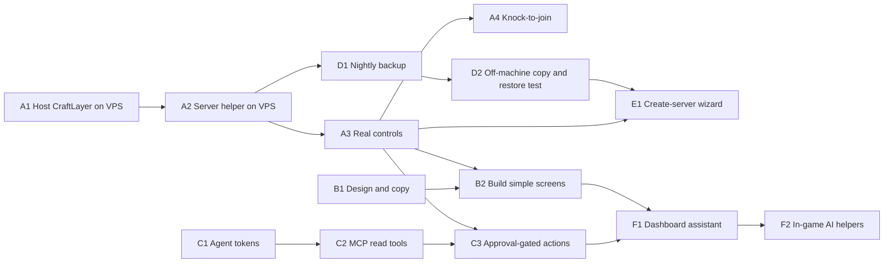

# CraftLayer master plan

**Last updated:** 2026-11-08. **Where we are:** see the [plan status board](plan/STATUS.md).

This is the single plan for turning CraftLayer into something a parent can actually use: manage the family Minecraft server from a phone, add or remove players, back up worlds, create new servers, and let AI agents help — safely. It sits on top of the existing engineering plan ([roadmap](delivery/roadmap.md), [Minecraft track](delivery/minecraft-track.md), [backlog](delivery/backlog.md)). Those stay the detailed source for completed and in-progress engineering tasks; this plan sets the **order and the user outcome**. Where they conflict on order, this plan wins ([ADR 0034](architecture/decisions/0034-master-plan-usable-first.md)). Where they conflict on safety, the stricter rule wins.

## Why a new plan

An honest look at the current state (2026-11-08):

- **The game works.** A separate family server runs on the VPS. Two children joined from iPads; an unknown account was refused.
- **The dashboard can't manage it.** The dashboard runs only on the owner's Mac. It can show a snapshot of the real server, but has no live connection and no buttons that change anything. Every real change so far was made by an engineer over SSH.
- **The interface is too technical.** Screens expose engineering states (captures, provenance, freshness, plan hashes) instead of answering "Is it on? Who's playing? Let George in."
- **Lots of safety machinery exists but is not wired to anything a person can press.** Identity, roles, audit, node enrollment, signed commands, reservations, approvals and backup rules are built and tested, but the last mile — a connection to the real server and simple controls — is missing.
- **No AI agent can use it.** There is no MCP server or agent credential yet.

So the plan is: **connect the real server, make it simple, open it to AI agents, then grow.**

## What "done" looks like

A parent opens CraftLayer on a phone, from anywhere, signs in, and sees:

> **Family Survival** — 🟢 On · 2 playing (Alex, Charlie)
> [ Players ] [ Turn off ] [ Back up now ] [ How to join ]

They tap **Players**, see "BigCrazyPickle tried to join 2 min ago — **Allow**", tap Allow, and George is in. No SSH, no restart, no account numbers.

An AI agent (for example Claude) connected through MCP can answer "Is the server up and who's on?" and can *ask* to let a player in, which the parent approves with one tap. Later, AI helpers can play in the world with the children under adult-approved presets.

## The plan at a glance

| # | Milestone | What you get | Plan file |
| --- | --- | --- | --- |
| A | **Live connection** | CraftLayer runs privately on the VPS, talks to the real server, and can actually do things | [A — live connection](plan/A-live-connection.md) |
| B | **Simple family UI** | Three plain-language screens; technical detail hidden under "Advanced" | [B — simple UI](plan/B-simple-ui.md) |
| C | **AI agent access** (ASAP) | Scoped agent tokens and an MCP server; read tools first, then approval-gated actions | [C — AI agent access](plan/C-ai-agent-access.md) |
| D | **Backups you can trust** | Nightly backups, off-machine copy, tested restore, shown as a simple ✓ | [D — backups](plan/D-backups.md) |
| E | **New servers in a few taps** | Create a new world from the phone with a 3-question wizard | [E — new servers](plan/E-new-servers.md) |
| F | **AI built in** | An assistant in the dashboard, then AI helpers in the game | [F — AI built in](plan/F-ai-built-in.md) |

How work is run, checked and published: [how to run the plan](plan/RUNNING.md). Decisions only the owner can make are listed on the [status board](plan/STATUS.md#decisions-needed-from-the-owner).

## Order and what can run in parallel

**Fastest useful path:** A1 → A2 → A3 gives real buttons. C1 → C2 runs alongside, so an AI agent can read server status as soon as A2 lands. B1 (design) starts immediately because it needs no code.

## Rules that do not change

These come from [AGENTS.md](../AGENTS.md) and apply to every step:

- Worlds are irreplaceable: no overwrite, delete or migration without a verified backup and explicit approval.
- Allowlist and online sign-in stay on. No offline mode. No public RCON, Docker, database or admin ports.
- Children cannot change players, servers, backups, network or credentials.
- AI agents and MCP callers never approve their own requests or bypass permissions; a model's text is never an approval.
- No paid AI usage without explicit owner permission; free-only is the default.
- Every step ends with checks, an updated status board, a commit and a push to `origin main`.

## Relationship to existing chapters

| Plan step | Existing task it completes or reorders |
| --- | --- |
| A2–A3 | CL-F25-01 (node agent), CL-F2-02 (allowlist operations), CL-F3-01 (start/stop/restart) for the owned server |
| A4 | CL-F2-01 (verified Bedrock identity) |
| B | CL-F1-03 / CL-F25-04 UI, replacing the current server and host consoles for everyday use |
| C | CL-F25-04 MCP subset, moved earlier; remote MCP auth per [management architecture](architecture/minecraft-management.md) |
| D | CL-F2-03, CL-F2-04 |
| E | CL-F25-03 to CL-F25-05 |
| F2 | Chapters 04–06 (still need separate authorization) |
| F1 | New: dashboard assistant using the existing [provider gateway](chapters/02-provider-gateway.md) |

Chapter 04 and later remain gated until the owner authorizes them. This plan does not by itself authorize production changes; each VPS-touching step says what approval it needs.
