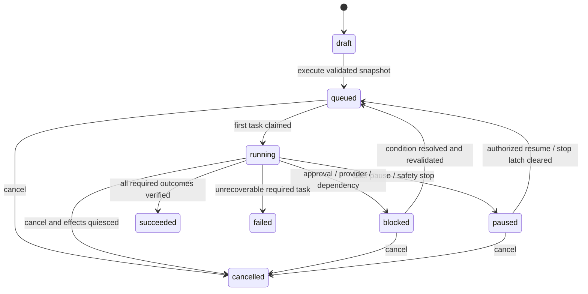

# Runtime, scheduling and AI execution

Status: proposed behavioral contract. Implement the state machine before considering an agent framework.

## Mission lifecycle

Terminal missions never restart in place. Retry/re-run creates a new mission or explicit new execution generation with a fresh snapshot/grant. Additive state transitions require versioned contracts. `reason_code` distinguishes budget, stop latch, provider unavailable, permission revoked, approval required and environment disconnected; do not overload free-text status.

Pause stops new claims and cooperatively stops bounded active actions, preserving verified work. Cancel sets a durable cancellation request; active tasks must finish stopping or become uncertain before terminal cancellation is reported. Emergency stop latches one or more scopes; it initiates pause/quiescence and does not declare physical effects undone.

## Task and agent states

Tasks: `pending` dependencies → `ready` → `leased` → `running` → `succeeded`. Other valid states: `retry_wait`, `blocked`, `cancel_requested`, `cancelled`, `failed`, `skipped`. Required dependency failure fails/blocks dependents by explicit template policy; optional edges are explicit. Reject cycles, duplicate nodes, missing references, oversized graphs and unauthorized task kinds at submission.

Agents: `provisioning`, `idle`, `assigned`, `busy`, `stopping`, `offline`, `error`, `disabled`. Agent state is a projection of session/heartbeat and assignments; a stale online card never authorizes an action. Worker availability and agent lifecycle are separate concepts.

## Reliable dispatch algorithm

1. Validate finite DAG, scope, capabilities, resource ceilings and immutable template/policy snapshot. Persist with an execution grant and outbox event.
2. Scheduler scans authorized organizations fairly with bounded per-org batches. Prefer ready tasks whose dependencies are verified; enforce concurrent-agent and mission quotas.
3. Relay publishes reference-only job `{schema_version, event_id, organization_id, task_id, execution_generation}`. Organization is a lookup hint, not proof; canonical task and worker binding must agree.
4. Worker authenticates, reloads task/mission/grant, checks current membership, policy, stop epochs and capability, then atomically leases the task and increments its fence.
5. Revalidate immediately before each external effect. Heartbeat every 5 s initially; lease lifetime 15 s and action deadline no later than the lease safety boundary.
6. Commit result only when fence/generation and expected state match. Store effect receipt, task transition, usage settlement, audit and outbox in bounded transactions as appropriate.
7. Recovery detects missed publishes, expired leases and uncertain effects. Reconcile observed external state before repeating actions. Queue retention or job ID deduplication is not durable business idempotency.

Queue delivery can repeat after a stalled worker, and completed job removal affects queue-level deduplication. This design therefore treats database execution records as authoritative. [BullMQ stalled jobs](https://docs.bullmq.io/guide/jobs/stalled), [job IDs](https://docs.bullmq.io/guide/jobs/job-ids).

Do not claim exactly-once physical actions. Fences protect database commits; Minecraft and external systems must additionally enforce single active sessions/action dispatch, preconditions, bounded action cancellation, and reconciliation after partitions. A stale worker with an open game connection is an explicit fault test.

## Stop protocol

Persist stop latch and increment applicable scope epoch atomically with audit/outbox. Return a stop operation ID with `requested`, `acknowledged`, `quiesced` and `unreachable` worker counts. Reject new claims and model/tool dispatch after commit. Notify workers via fast path, while heartbeat/lease checks remain the fallback. Disconnect bots and terminate sandbox processes if cooperative cancellation exceeds deadline.

A worker unable to prove valid lease/policy must stop further effects. Blocked network calls have client-side deadlines and process supervision. Initially target no further actions after 20 s of lost control-plane contact, including grace; verify with partition tests before release. A stopped task with uncertain effect stays blocked pending reconciliation.

Clearing a latch requires scope-specific adult/operator permission and an explicit audit reason. It never resumes missions automatically. Child Stop All applies to assigned permitted Minecraft resources; instance and org stop are adult/privileged actions. Provide an owner-only local emergency command so UI failure does not remove the stop path.

## Agent execution loop

Observe → redact/normalize → retrieve bounded context → decide if deterministic execution suffices → optionally request structured plan → validate → authorize → reserve resources → execute bounded action → verify → publish concise result.

LLMs propose task/tool parameters; they do not execute shell strings or change permissions. Tool registry entries define JSON schema, capability, side-effect class, timeout, output-size limit, idempotency/reconciliation strategy and approval requirement. Unknown tools/fields or invalid structure are rejected. Limit plan repair to two attempts initially; persistent invalid plans block the task with a clear reason.

Planner output contains schema version, bounded task nodes, edges, expected outcomes, required tools, estimated resources and confidence/assumptions. Server assigns canonical IDs and validates references. Initial caps: 50 tasks/mission, 10 tool calls/task, 2 repair attempts, 3 task attempts; configure downward per child preset. These are proposed testable defaults.

Use deterministic blueprints and action libraries for movement, inventory, placement and verification. A planner cannot convert “build shelter” into arbitrary game commands. For coding, every command uses an executable/argv allowlist inside the sandbox; no shell interpolation. Research URLs pass separate network policy before fetching.

## Blackboard and cooperation

Store typed facts: resource sightings, inventory summaries, reservation ownership, blueprint progress, task outcomes and hazard notices. Each entry includes organization/mission, source agent/task, observation time, confidence, schema version and TTL. Hard byte/entry/context-token limits; summarize or expire data. Never share raw provider secrets, login sessions, arbitrary global memory or unbounded agent chats.

A reservation has resource key/range, owner, lease and fence. Shared-chest transfers compare before/after inventory, reserve quantities and reconcile interrupted transfers. Commander assigns work through the scheduler; it cannot directly override other agents or stop/budget policy.

## Retry and error taxonomy

Transient transport/429 → bounded exponential backoff with jitter and eligible fallback. Invalid credentials → disable connection and block. Invalid plan/schema → limited repair, then block. Permission/stop/budget failure → no automatic bypass/retry. Lost lease → cease effects and reconcile. Ambiguous external success → `uncertain`, never blind retry. Unrecoverable task failure → explicit mission dependency policy. All retries consume relevant token/tool/time quotas.

## AI evaluation and reproducibility

Record redacted prompt/template version, model ID, price/policy snapshot, sampling parameters, context references, tool decisions, latency and verifier outcomes. Raw prompt/response retention is opt-in, protected and bounded; child/private data stays minimized. Do not store chain-of-thought; store short decisions and observable evidence.

Maintain fixtures for valid/invalid plans, prompt injection, unreachable resources, conflicting reservations, insufficient materials and fabricated research claims. Evaluate schema success, completion, tool violations, paid dispatch count, cost/tokens, latency and human review quality. Deterministic mode is the CI baseline; real model evaluations are separately authorized and never overwrite stable fixtures silently.

## Reconciled implementation and management boundary

ADR 0014 and migrations 0008–0015 are authoritative for current simulation states (including `cancelling`), API-coordinator ownership, bearer-only workers, stops, approvals and scoped SSE through CL-03-06. The diagrams above retain the original conceptual model; final runtime qualification remains CL-03-07. Server-management operations reuse reliability principles through separate domain ports, not arbitrary mission tools. No Minecraft/Docker/RCON capability exists in the simulation registry. [Management architecture](minecraft-management.md) defines its own operation/backup grants, current-authority guards and privileged node protocol; no LLM is required.
