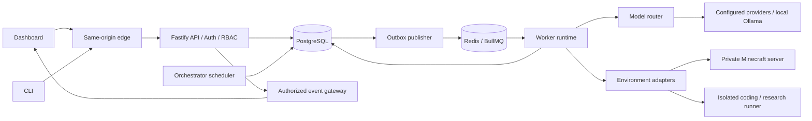

# System design and package boundaries

Status: proposed; see [ADRs](decisions/README.md). Exact package/runtime versions are selected in Chapter 00 using supported releases and compatibility probes.

## Runtime topology



PostgreSQL is authoritative. Redis accelerates dispatch, cooldowns and notifications; losing Redis must not erase missions, budget reservations, stops, approvals or audit history. No distributed transaction spans PostgreSQL and Redis: the outbox and reconciliation process close that gap.

Deploy distinct API, web and worker processes from the monorepo. The scheduler/outbox relay may initially run as worker process roles, with database leases for safe multiple instances. Keep interfaces separate so they can split later without rewriting domain logic. A web process never imports database or provider credentials.

## Planned repository layout

```text
apps/
  api/                     Fastify plugins, routes, auth/session transport
  web/                     Next.js dashboard and role-aware UX
  worker/                  Scheduler, outbox relay, worker startup/shutdown
  cli/                     Typed-client commands and local credential handling
packages/
  core/                    IDs, errors, policies, domain schemas, clocks
  contracts/               Public API/event schemas and versioning
  config/                  Server config validation; no browser secret exports
  auth/                    Sessions, authorization, invitation workflows
  db/                      Drizzle schema, migrations, scoped repositories
  orchestrator/            State transitions, DAG, leases, recovery, stop logic
  agent-runtime/           Observe/plan/validate/act loop and capabilities
  model-router/            Eligibility, reservations, routing, settlement
  provider-adapters/       Concrete provider transports
  environment-minecraft/   Mineflayer lifecycle and deterministic actions
  environment-coding/      Sandbox broker client and patch workflow
  environment-research/    Safe fetch/extract/citation workflow
  sdk/                     Generated typed REST client, event client
  testkit/                 Seed fixtures, fake clocks/providers/adapters
examples/
  minecraft-village/       Versioned templates, blueprints, test world recipe
  coding-team/             Habit tracker fixture, allowlisted commands
  research-team/           Hosting comparison fixture and report schema
infra/
  compose/                 Profiles, service hardening, local TLS guidance
  images/                  Multi-stage image recipes
scripts/                   Setup, migration, verification, backup tooling
docs/                      Specifications and operational documentation
```

Create packages only when the chapter introduces real behavior; placeholder package directories are not a milestone. Additions beyond the blueprint (`cli`, `contracts`, `sdk`, `agent-runtime`, `testkit`, `config`) make ownership and test boundaries explicit.

## Dependency rules

| Layer | May depend on | Must not depend on |
| --- | --- | --- |
| core/contracts | Validation and pure utilities | Database, queue, framework, provider SDK |
| db/auth | core/contracts and DB implementation | Web UI or Minecraft |
| orchestrator | core, repository/provider/environment interfaces | Mineflayer or specific model SDK |
| agent-runtime | core, tool/model interfaces | Dashboard or unscoped DB access |
| provider/environment adapters | core/contracts and their transport SDK | API routes or UI |
| model-router | core, repository/adapter interfaces | Browser/session transport |
| api | Application services and contracts | Direct Mineflayer internals |
| web/cli/sdk | Public contracts/client | DB credentials, provider secrets, server internals |

Composition roots in apps wire implementations. Enforce dependency directions with lint rules and browser bundle import tests. Do not add a general agent framework until a concrete limitation and ADR justify it.

## Request and execution flow

1. Edge serves web/API on one origin. API authenticates a session or a scoped CLI credential and resolves organization/project access.
2. Application service validates permission, resource scope, optimistic version, environment policy, quotas and stop state.
3. One database transaction writes state change, audit event and outbox event. Response returns resource ID/version; it does not imply the task has executed.
4. Relay emits a versioned job with references and hashes, then records publish status. Duplicate publish is safe.
5. Worker reloads canonical state, validates current authorization and execution grant, claims a lease, and receives a monotonically increasing fence.
6. Runtime requests a budgeted model plan only if needed. Tool registry validates its output against capabilities; deterministic adapter executes bounded effects.
7. Results commit with current fence/version. Outbox emits progress; WebSocket/SSE clients receive only authorized projections.
8. Recovery scans overdue leases, missing dispatches, unacknowledged stop requests and uncertain effects. It reconciles before retrying external actions.

## Infrastructure boundaries

- Browser uses secure cookies, CSRF protections and no provider-key access. Same-origin routing avoids permissive cross-origin defaults.
- API owns control-plane writes and runtime services own validated transitions. Never let arbitrary UI state become an execution command.
- Minecraft protocol workers can share a trusted local worker host for the first demo; that is not an isolation boundary for hostile code.
- Coding runners are separately restricted execution environments. A narrow trusted broker manages them; API and agent tasks do not control the host Docker daemon.
- Research fetches use restricted egress and reject private/metadata destinations. An administrator-configured local model endpoint is a distinct trust policy from an untrusted research URL.
- Core has no Cloud environment variables required for boot. Provider adapters are optional and have explicit endpoints.

## Configuration precedence

Compiled safe defaults → validated installation config → organization policy → project/environment restrictions → mission request. Lower layers may narrow authority but cannot widen instance restrictions. Security policies combine by intersection; quotas use the tightest applicable remaining limit. Unknown keys and incompatible versions fail validation.

Secrets are referenced by opaque credential ID or environment-variable name, never embedded into exported templates. Validate provider URL schemes, resolved networks and redirects against administrator policy. Local Ollama access requires an explicit local inference endpoint allowlist.

## Compatibility and evolution

Use versioned `/api/v1` REST routes, versioned event envelopes, adapter capability declarations and versioned mission templates. Persist template snapshot/hash on every mission. Require minimum worker protocol version during claim. Old workers must refuse unsupported payloads without executing effects.

Migration strategy is expand → compatible deploy → backfill → contract. Record image/schema compatibility per release. A DB downgrade is not assumed safe; use tested forward repair or coordinated restore.

## Failure domains

API down: workers obey previously bounded leases; no new user commands. Redis down: durable state survives, dispatch pauses and reconciles. PostgreSQL down: stop new actions/model calls because current leases/policy cannot be proven. Model provider down: bounded fallback through eligible models only. Minecraft down: bounded reconnect and world reconciliation. Browser down: missions continue within granted limits. Runner partition: heartbeat expiry stops effects; reconnect cannot clear a stop latch.
