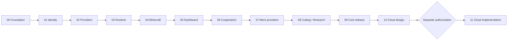

# Delivery roadmap and critical path

Chapter 00 is implemented and verified with review evidence; Chapters 01–11 remain planned and not implemented. There are no promised dates. Size and schedule depend on auth decisions, Minecraft protocol/auth compatibility, sandbox choice and reference hardware measurements.

## Chapter sequence

| Chapter | Milestone | Delivery gate |
| --- | --- | --- |
| [00 — Foundation](../chapters/00-foundation.md) | M0 | Reviewed acceptance evidence required |
| [01 — Identity and RBAC](../chapters/01-identity-and-rbac.md) | M0 | Reviewed acceptance evidence required |
| [02 — Provider gateway](../chapters/02-provider-gateway.md) | M1 | Reviewed acceptance evidence required |
| [03 — Fleet engine](../chapters/03-fleet-engine.md) | M1 | Reviewed acceptance evidence required |
| [04 — Minecraft adapter](../chapters/04-minecraft-adapter.md) | M2 | Reviewed acceptance evidence required |
| [05 — Dashboard and Kid Mode](../chapters/05-dashboard-and-kid-mode.md) | M2 | Reviewed acceptance evidence required |
| [06 — Cooperative armies](../chapters/06-cooperative-armies.md) | M2 | Reviewed acceptance evidence required |
| [07 — Additional providers](../chapters/07-additional-providers.md) | M3 | Reviewed acceptance evidence required |
| [08 — Coding and research adapters](../chapters/08-coding-and-research.md) | M3 | Reviewed acceptance evidence required |
| [09 — Self-hosted release](../chapters/09-self-hosted-release.md) | M4 | Reviewed acceptance evidence required |
| [10 — Cloud architecture — design only](../chapters/10-cloud-architecture.md) | M5 | Reviewed acceptance evidence required |
| [11 — Optional Cloud implementation](../chapters/11-cloud-implementation.md) | M6 | Reviewed acceptance evidence required |

## Dependency graph

## Milestone review questions

- M0: Can a new developer start privately, and can two organizations be proven isolated?
- M1: Can the runtime survive duplicate delivery, restart and uncertain effects without policy bypass or hidden spend?
- M2: Can a fresh child session launch a preset while two bots finish a verifiable build and Stop All remains accurate?
- M3: Do every provider/adapter and untrusted coding/research path preserve the same contracts and limits?
- M4: Can a non-author operator install, recover and upgrade the advertised features without Cloud?
- M5: Is a managed BYOK service commercially and operationally justified using measured costs?
- M6: Is the separately authorized service safe to expose after private beta evidence?

## Scope management

Use a new ADR to change release scope or architecture. Do not silently remove security tests to meet an arbitrary date. A Minecraft-only preview can precede full Core if documented explicitly; coding/research must not be advertised before verified. Keep Cloud implementation out of the Core critical path.

The original planning task was followed by the authorized Chapter 00 build. The next implementation task is CL-01-01 after Chapter 01 authorization. See current delivery status before choosing work.
