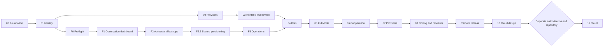

# Delivery roadmap and critical path

Updated 2026-11-02: [F0 local implementation/review](../reviews/F0-preflight.md) delivered; F1 requires authorization. Chapters 00–02 are implemented/verified and accepted for advancement; CL-03-01–06 verified, CL-03-07 open. Original IDs/implemented behavior remain intact. No promised dates. [REC-01 gap analysis](unified-reconciliation.md) and [ADR 0015](../architecture/decisions/0015-unified-control-plane.md) explain the changed delivery order.

## Immediate management sequence

| Phase | Dependency / outcome | Authority |
| --- | --- | --- |
| [F0 preflight](../chapters/F0-preflight.md) | Existing foundation/identity → redacted inventory/preservation and remediation plan | Coding needs F0 approval; production inspection/backup separate |
| [F1 control plane](../chapters/F1-control-plane.md) | F0 local gate + 00–01 → earliest read-only parent dashboard | New phase approval; no LLM/bot/Chapter 03 completion dependency |
| [F2 family access](../chapters/F2-family-access.md) | F1 → verified Java/Bedrock access + recoverable scheduled backups | New phase approval; earliest family-ready management milestone with real evidence |
| [F2.5 provisioning](../chapters/F2.5-docker-provisioning.md) | F2 → secure nodes, approved Docker plans/provision/rollback and MCP subset | New phase approval; explicit EULA and host plan approval before deploy |
| [F3 operations](../chapters/F3-server-operations.md) | F2.5 → approved adopted lifecycle, monitoring, updates/decommission | New phase approval; full initial management dashboard scope |

[Sixteen-task Minecraft track](minecraft-track.md) is the dedicated execution index. F1 can use synthetic captured inventory while production permission is pending. F2 uses disposable worlds for development. Contabo details/readiness stay unverified until approved evidence. Complete already-authorized CL-03-07 separately; no new agent functionality blocks F0–F2.

## Preserved chapter sequence

| Chapter | Milestone | Current state / subsequent dependency |
| --- | --- | --- |
| [00 Foundation](../chapters/00-foundation.md) | M0 | Complete; preserve |
| [01 Identity/RBAC](../chapters/01-identity-and-rbac.md) | M0 | Complete; reuse, extend scoped permissions |
| [02 Providers](../chapters/02-provider-gateway.md) | M1 | Complete; optional to management |
| [03 Fleet engine](../chapters/03-fleet-engine.md) | M1 | Six tasks verified; final runtime review still authorized |
| [04 Minecraft bots](../chapters/04-minecraft-adapter.md) | M2 | After management track + Chapter 03 gate and separate authorization; reuse server fixtures |
| [05 Dashboard/Kid Mode](../chapters/05-dashboard-and-kid-mode.md) | M2 | After 04; extend existing account/F dashboard shell |
| [06 Cooperative armies](../chapters/06-cooperative-armies.md) | M2 | After 05; verified two-bot shelter, Stop All |
| [07 More providers](../chapters/07-additional-providers.md) | M3 | After 06 by default; optional adapters |
| [08 Coding/research](../chapters/08-coding-and-research.md) | M3 | After 07; isolated examples |
| [09 Self-hosted release](../chapters/09-self-hosted-release.md) | M4 | All Core/F claims verified; full DB/artifact/key recovery, upgrades/release |
| [10 Cloud design](../chapters/10-cloud-architecture.md) | M5 | After secure useful Core; design only |
| [11 Separate Cloud](../chapters/11-cloud-implementation.md) | M6 | Explicit separate repository/authorization; never Core prerequisite |

## Dependency graph

## Review and scope

F1 proves useful observations, not child-safe joins. F2 must prove real identity/access denial, private entry and isolated restore, with actual Contabo authorization/evidence before a production-ready claim. F2.5 must prove all provisioning failure/preservation gates. F3 adds the lifecycle portion of the unified initial deliverable. M2/M3 preserve original agent outcomes; M4 requires every advertised Core feature plus fresh install/recovery/upgrade and security evidence.

Each phase/chapter boundary needs reviewed evidence and authorization; plan order is not permission. No production deployment, world operation, VPS purchase, paid inference, publication or Cloud implementation is included in REC-01. Full scope and test mappings live in [requirements](../product/requirements.md) and [acceptance](../testing/minecraft-management.md).
