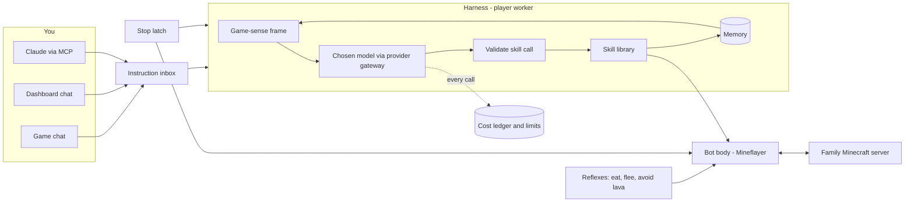
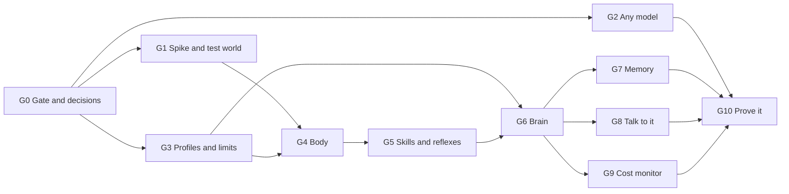

# Milestone G — AI player harness (next)

Part of the [master plan](../MASTER_PLAN.md). Status lives on the [status board](STATUS.md). Decision record: [ADR 0051](../architecture/decisions/0051-ai-player-harness.md).

## Goal

The owner creates a named AI player, picks the model that drives it, and talks to it. It joins the family world as a real player, understands what is going on in the game, remembers what it has learned, does what it is asked, and stops spending when it reaches the limit the owner set.

> **Pip** — 🟢 In game · Family Survival · Model: *claude-sonnet (Anthropic)* · Today $0.41 of $2.00
> Doing: *collecting oak logs for Alex's house (12/32)*
> [ Talk to Pip ] [ Memory ] [ Spending ] [ Stop ]

"Pip, follow me and chop any trees we pass." Pip answers in game chat, follows, and fills its inventory with logs. Later: "Pip, remember the chest by the farm is the wood chest." Tomorrow it still knows.

## What the owner gets

| Ability | How it works |
| --- | --- |
| **Pick any model** | Any model reachable through **OpenRouter** or **Kong AI Gateway** (first), a model on your own Ollama machine, or Anthropic, OpenAI and Google directly. The picker shows each model's price, context size and whether it can use tools; models that cannot call tools are not offered. Changing the model takes effect on the agent's next turn. |
| **A named player** | Each AI player has a name, a personality and standing rules you write. It starts on **your own Minecraft Java account**, so the server sees a normal signed-in player; its persona name goes in front of its chat ("Pip: on it"). A dedicated account with its own name can replace yours later without other changes. |
| **Master tasks** | A list of jobs you allow it to do on its own ("keep the wood chest stocked", "light up the base at night", "farm wheat"), each with a priority and when it applies. When nobody is instructing it, it works on the highest-priority master task that applies; with none, it waits at home and costs nothing. Your direct instructions can be anything its skills allow. |
| **Talk to it and give instructions** | In game chat (say its name), from a chat panel in the dashboard, or from Claude Code/Desktop through MCP. Instructions are plain language; it replies, asks when unclear, and reports when done or stuck. |
| **Memory** | It remembers the conversation, what happened, places (home, chests, farms), people (who likes what) and lessons ("creepers near the river at night"). You can read, correct and delete any memory. |
| **Reasoning and game sense** | Every turn the harness wraps your instruction in a *game-sense frame*: who it is, the rules, a Minecraft knowledge pack for the server's exact version (recipes, tools, mobs, day/night), what it sees right now, its current goals and the relevant memories. The model chooses from a fixed set of game skills; code carries them out. |
| **Cost monitoring and a hard limit** | Every model call is priced and recorded. You set a daily and a total limit per AI player (and token/call limits, which also apply to free local models). Warning at 80%; at the limit it stops calling the model, finishes or safely abandons what it is doing, says so in chat and waits. Nothing raises the limit except an adult. |

## How it works

**Three layers, so the model is not called on every tick.**

1. **Reflexes (no model, no cost):** eat when hungry, back away from lava and cliffs, flee or fight hostile mobs within rules, get unstuck. Always on.
2. **Skills (code):** `go_to`, `follow`, `come_here`, `collect` (logs, stone, crops…), `mine`, `craft` (from the pinned version's real recipes), `smelt`, `place`, `build` (small approved blueprints), `deposit`/`withdraw` (named chests only), `fight_hostile`, `eat`, `sleep`, `look_around`, `say`. Each checks its preconditions, region and protected zones, then reports a receipt (what changed, what failed).
3. **Brain (model):** called when an instruction arrives, when a skill finishes or fails, when something important happens (night falls, low health, you speak to it), and when it picks up or progresses a master task. With no instruction and no applicable master task it does not call the model. It returns a short reply, a short visible reason, and one or more skill calls. The harness validates each call against the skill schemas and the player's rules; invalid calls are repaired at most twice, then it asks you.

**Model choice.** One provider gateway for every model, so budgets, credentials and audit are shared. OpenRouter and Ollama adapters exist (Chapter 02). G2 adds, in this order:

1. **Kong AI Gateway connection.** Kong's AI proxy exposes an OpenAI-compatible chat endpoint in front of whichever providers you configure in Kong, so one connection reaches many models. An adult registers the gateway URL (it must be on the installation's endpoint allowlist and reachable from the VPS) and the Kong consumer credential, stored encrypted like other keys. The models offered are the ones configured on your Kong routes, entered or discovered by an adult. Usage comes back in each response. Prices come from the CraftLayer price table, because Kong does not publish a public catalog. You can mirror the same prices in Kong's own cost settings so Konnect analytics agree. Kong's own token rate limits can sit on top as a second safety net; CraftLayer's limit stays the one that stops the AI player.
2. **Generic OpenAI-compatible connection** for other compatible endpoints, under the same rules.
3. **Direct Anthropic, OpenAI and Gemini adapters** with tool calling, for when you want to go straight to a provider.

Prices come from the provider catalog where one exists (OpenRouter) and otherwise from an adult-maintained price table recording its source and date. A paid model with no known price cannot be selected.

**Memory.** Kept in PostgreSQL, per AI player and per world:

| Kind | Holds | Bounds |
| --- | --- | --- |
| Working | The current conversation and recent events | Summarized when it grows past its limit |
| Episodic | What it did and what happened, with outcomes | Kept 30 days by default; summarized into lessons |
| Facts | Places, people, preferences, lessons, the owner's standing notes | Size-capped; each fact shows its source and date |

Retrieval starts simple: most relevant by tags, place, people and recency. Search by meaning (embeddings) can come later, through a local Ollama embedding model, if simple retrieval proves too weak.

**Names and accounts.** The family server keeps online sign-in and its allowlist (these never change), so the AI player must sign in as a real Java account. **Decision 8: it uses the owner's own Java account to start.**

- You sign it in once through Microsoft's device-code page. The session is stored encrypted on the server, used only by the player worker, and never shown to the model. Revoking it is one button; signing out of the Microsoft account also ends it.
- In game it appears under your account's name. Its persona name goes in front of its chat, and it answers to either name.
- **Your account can be in the game only once.** While the AI player is on, you play from your iPad (Bedrock) or another account. If you join on Java with the same account, Minecraft disconnects the AI player. The harness treats that as "the owner wants the account back": it stays off and never reconnects over you, until you start it again.
- Because the AI player *is* your Java account, the game cannot tell you apart by name. In-game instructions are accepted from your **other** identity (for example your Bedrock gamertag), configured by its account ID rather than by name text.
- A dedicated account with its own name can replace yours later; only the sign-in changes.

## Safety rules

These come from [AGENTS.md](../../AGENTS.md) and [world safety design](../architecture/minecraft-cooperation.md):

- The AI player has **no operator rights, no commands, no RCON, no Docker** and runs in its own worker process, separate from the server helper.
- **Free run of the world (decision 11).** It may go, dig and build anywhere. Protected zones exist as an option you can switch on later, but none are set by default.
- **Every block it changes is journaled** (where, what was there, what it became, which task). You can review what it did and repair it if needed.
- **Family world only with a working backup.** Because it can change anything, it does not join the family world until at least one verified backup and its off-server copy exist (Milestone D). The test world comes first.
- **No attacking players, pets or villagers.** Hostile mobs only. This rule stays even with free run of the world, because the children play there.
- **Only you give instructions (decision 10).** Instructions come from the dashboard, from MCP with your agent token, and from your own in-game identity. Everyone else's chat, including the children's, is treated as conversation, never as an instruction. Chat, signs and book text are never instructions, however they are worded. Preset phrases for children can be added later.
- **What it says is checked.** Replies to the game are short and pass a safety filter before sending; every message is in the transcript the owner can read.
- **Stop works without the model.** Per-player Stop and Stop All use the existing durable stop latch: the body stops moving and disconnects if needed, even if the model or the dashboard is down. Clearing a stop is an adult action.
- **Spending.** No paid call without a configured limit. The limit check happens *before* each call (reservation in the existing ledger), so a burst of calls cannot overshoot it.
- **Reasoning is not stored as chain-of-thought.** The harness stores the short visible reason, the skill calls and their receipts.

## Steps

| Step | What | Depends on | Maps to |
| --- | --- | --- | --- |
| **G0** | Owner gate: accept the Chapter 03 review and authorize Milestone G. Decisions 8–12 answered 2026-11-15 | — | Chapter 03 acceptance; Chapter 04 authorization |
| **G1** | Compatibility spike and private test world: pin Mineflayer and its pathfinder against the family server's exact version; a sealed local Paper test world (seeded, never public); prove sign-in with the owner's account (device code) | G0 | CL-04-01, CL-04-02 |
| **G2** | Pick any model: Kong AI Gateway connection, generic OpenAI-compatible connection, then direct Anthropic, OpenAI and Gemini adapters, all with tool calling and usage; price table with provenance; one model catalog across all connections; connection setup in the dashboard (keys stay encrypted, server side) | G0 | Part of Chapter 07, moved earlier |
| **G3** | AI player profiles, master tasks and spending limits: name, personality, rules, model, Minecraft account sign-in, assigned world, owner's instructing identity, master task list, optional protected zones; a per-player budget scope with daily and total limits in the existing ledger ($1/day, $10 total to start); adult-only API, SDK and audit | G0 | New (reuses Chapters 01–02) |
| **G4** | The body: player worker process, one game session per AI player, stop latch, bounded reconnect that never takes the account back from the owner, death/kick handling, observations (position, health, hunger, inventory, nearby blocks, mobs and players, time) | G1, G3 | CL-04-03, CL-04-04 |
| **G5** | Skills and reflexes: the skill library above with optional zone checks, receipts, after-checks and the block journal; reflexes; recovery after a disconnect mid-action | G4 | CL-04-05, CL-04-06 |
| **G6** | The brain: harness loop, game-sense frame and knowledge pack, skill-call validation and repair, goal list, master-task picking when idle, when-to-think triggers, visible reasons. Tested with a scripted fake model first, so CI needs no AI calls | G3 (fake body), G5 (real body) | New |
| **G7** | Memory: working, episodic and facts; summarizing; retrieval; dashboard view to read, correct and forget | G6 | New |
| **G8** | Talk to it: in-game chat from the owner's identity, dashboard chat panel with a live "what it's doing" view, MCP tools (`list_ai_players`, `instruct_ai_player`, `get_ai_player_status`, `stop_ai_player`) on the existing agent tokens; outgoing chat filter | G6 | Extends Milestone C |
| **G9** | Cost monitor: live spend per player (today, total, per call, tokens, model), warning at 80%, the at-limit behaviour, spend history and export | G3, G6 | Extends Chapter 02 reporting |
| **G10** | Prove it: scenario suite on the test world ("follow me", "collect 16 logs", "craft a crafting table and a wooden pickaxe", "put the logs in the wood chest", "remember…, recall tomorrow", a master task picked up when idle, the owner joining on the same account, "stop now", "limit reached"), first with a local Ollama model, then one model through OpenRouter and one through Kong AI Gateway under the $1/day limit. Then, once a verified family-world backup exists, a supervised trial on the family world with the owner. Measure stop time and cost per task. Review | G5–G9, D1 for the family-world trial | CL-04-07 plus Milestone G review |

G1, G2 and G3 run in parallel. G6 starts against a fake body as soon as G3 lands and switches to the real body after G5. **First moment you can talk to it in game:** end of G8 on the test world (with Ollama or a paid model under a cap). **On the family world:** after G10's supervised trial.

### Done when

The owner creates an AI player, names it, picks a model from each kind of source (OpenRouter, Kong AI Gateway, Ollama, a direct provider) and switches between them; it works through allowed master tasks when idle; instructs it from game chat, the dashboard and Claude; it completes the G10 scenarios on the test world and in a supervised family-world session; it recalls a fact the next day; spending matches the ledger and it stops at the limit without overshooting; Stop halts it within the measured deadline with the model unreachable.

## Owner decisions (answered 2026-11-15)

| # | Question | Answer |
| --- | --- | --- |
| 8 | How the AI player signs in (online sign-in stays on, so no offline account) | **The owner's own Java account.** A dedicated account may replace it later. A server-side no-account NPC plugin was considered and not chosen (it runs inside the live server with full power) |
| 9 | Which models, and the first spending limit | **Any model**; it must work with **OpenRouter and Kong AI Gateway**. **$1/day and $10 total** per AI player to start, changeable by an adult |
| 10 | Who may give it instructions | **Only the owner** for now |
| 11 | Where it may dig and build | **Anywhere: free run of the world.** Still no attacking players, pets or villagers; every change journaled; family world only once a verified backup exists |
| 12 | What it does when not instructed | **A set of master tasks the owner allows.** The list governs unasked work only; direct instructions from the owner can be anything its skills allow |

Still needed for G0: accept the Chapter 03 review and say go for Milestone G.

## Risks

- **Version support (G1, 2026-11-15: resolved with a bridge).** Mineflayer stops at 26.1 and the family server runs 26.3. G1 proved the bot plays through the ViaVersion/ViaBackwards server plugins ([record](../development/ai-player.md)). Installing them on the family server is a production change needing a restart, a verified backup and the owner's approval (decision 13). When Mineflayer supports 26.3 natively, the bridge can be removed.
- **Model quality varies.** Small local models may choose poor skills. The harness keeps the model's job small (choose a skill and its arguments), and G10 reports results per model so you can see which ones are good enough.
- **Cost of chatty play.** Event-driven thinking, cheap reflexes, a cap on calls per minute and prompt caching where the provider supports it keep calls down. The hard limit is the backstop.
- **Children and a talking AI.** It may chat with the children but takes instructions only from the owner; everything it says is filtered and logged.
- **Your own account on a server.** The stored session is for your Minecraft account. It is encrypted, held only by the player worker and revocable. A compromise of the VPS could misuse it to play as you on Minecraft servers until you revoke it. A dedicated account removes this.
- **Free run of the world.** A model mistake can damage the children's builds. The block journal shows what changed; the backup is the recovery path; protected zones can be switched on at any time.

## How this relates to Milestone F

G delivers **F2a** (one helper in the game) and goes further for adults: free-text conversation, memory, choice of model. **F2b Kid Mode** and **F2c teams** build on G's profiles, skills and limits. **F1 dashboard assistant** shares G2's model choice and moves after G.
