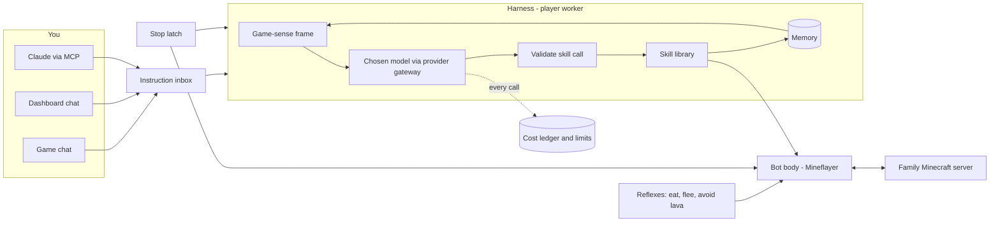
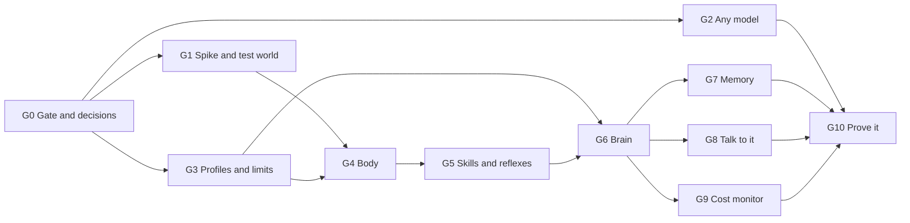

# Milestone G — AI player harness (next)

Part of the [master plan](../MASTER_PLAN.md). Status lives on the [status board](STATUS.md). Decision record: [ADR 0051](../architecture/decisions/0051-ai-player-harness.md).

## Goal

The owner creates a named AI player, picks the model that drives it, and talks to it. It joins the family world as a real player, understands what is going on in the game, remembers what it has learned, does what it is asked, and stops spending when it reaches the limit the owner set.

> **Pip** — 🟢 In game · Family Survival · Model: *claude-sonnet (Anthropic)* · Today $0.41 of $2.00
> Doing: *collecting oak logs for Alex's house (12/32)*
> [ Talk to Pip ] [ Memory ] [ Spending ] [ Stop ]

"Pip, follow me and chop any trees we pass." Pip answers in game chat, follows, and fills its inventory with logs. Later: "Pip, remember the chest by the farm is the wood chest." Tomorrow it still knows.

## What the owner gets

| Ability | How it works |
| --- | --- |
| **Pick any model** | Choose from Anthropic, OpenAI and Google (the main foundation-model providers), any model on OpenRouter, or a model on your own Ollama machine. The picker shows each model's price, context size and whether it can use tools; models that cannot call tools are not offered. Changing the model takes effect on the agent's next turn. |
| **A named player** | Each AI player has a name, a personality and standing rules you write. In game it plays as its own Minecraft Java account, so the server, allowlist and the children on iPads see it as a normal player. |
| **Talk to it and give instructions** | In game chat (say its name), from a chat panel in the dashboard, or from Claude Code/Desktop through MCP. Instructions are plain language; it replies, asks when unclear, and reports when done or stuck. |
| **Memory** | It remembers the conversation, what happened, places (home, chests, farms), people (who likes what) and lessons ("creepers near the river at night"). You can read, correct and delete any memory. |
| **Reasoning and game sense** | Every turn the harness wraps your instruction in a *game-sense frame*: who it is, the rules, a Minecraft knowledge pack for the server's exact version (recipes, tools, mobs, day/night), what it sees right now, its current goals and the relevant memories. The model chooses from a fixed set of game skills; code carries them out. |
| **Cost monitoring and a hard limit** | Every model call is priced and recorded. You set a daily and a total limit per AI player (and token/call limits, which also apply to free local models). Warning at 80%; at the limit it stops calling the model, finishes or safely abandons what it is doing, says so in chat and waits. Nothing raises the limit except an adult. |

## How it works

**Three layers, so the model is not called on every tick.**

1. **Reflexes (no model, no cost):** eat when hungry, back away from lava and cliffs, flee or fight hostile mobs within rules, get unstuck. Always on.
2. **Skills (code):** `go_to`, `follow`, `come_here`, `collect` (logs, stone, crops…), `mine`, `craft` (from the pinned version's real recipes), `smelt`, `place`, `build` (small approved blueprints), `deposit`/`withdraw` (named chests only), `fight_hostile`, `eat`, `sleep`, `look_around`, `say`. Each checks its preconditions, region and protected zones, then reports a receipt (what changed, what failed).
3. **Brain (model):** called when an instruction arrives, when a skill finishes or fails, when something important happens (night falls, low health, a player speaks to it), and at a slow idle heartbeat you can turn off. It returns a short reply, a short visible reason, and one or more skill calls. The harness validates each call against the skill schemas and the player's rules; invalid calls are repaired at most twice, then it asks you.

**Model choice.** One provider gateway for every model, so budgets, credentials and audit are shared. OpenRouter and Ollama adapters exist (Chapter 02). G2 adds direct Anthropic, OpenAI and Gemini adapters with tool calling. Prices come from the provider catalog where one exists (OpenRouter) and otherwise from an adult-maintained price table recording its source and date. A paid model with no known price cannot be selected.

**Memory.** Kept in PostgreSQL, per AI player and per world:

| Kind | Holds | Bounds |
| --- | --- | --- |
| Working | The current conversation and recent events | Summarized when it grows past its limit |
| Episodic | What it did and what happened, with outcomes | Kept 30 days by default; summarized into lessons |
| Facts | Places, people, preferences, lessons, the owner's standing notes | Size-capped; each fact shows its source and date |

Retrieval starts simple: most relevant by tags, place, people and recency. Search by meaning (embeddings) can come later, through a local Ollama embedding model, if simple retrieval proves too weak.

**Names and accounts.** The family server keeps online sign-in and its allowlist (these never change). So each AI player needs its own **Minecraft Java account**. The in-game name is that account's profile name: choose it when you buy the account (for example `PipTheHelper`). The dashboard name and the in-game name can differ, and it answers to both. The account is signed in once by an adult through Microsoft's device-code page; the session is stored encrypted on the server and never shown to the model. The account joins the allowlist through the normal adult approval.

## Safety rules

These come from [AGENTS.md](../../AGENTS.md) and [world safety design](../architecture/minecraft-cooperation.md):

- The AI player has **no operator rights, no commands, no RCON, no Docker** and runs in its own worker process, separate from the server helper.
- **Protected zones.** Adults mark the children's builds and the spawn area; it cannot break or place blocks there. It works only inside its allowed area.
- **No attacking players, pets or villagers.** Hostile mobs only.
- **Only trusted voices give instructions.** By default only the owner's in-game name and the dashboard/MCP can instruct it. Children's chat is treated as untrusted; if an adult allows it, children may use a short list of preset phrases ("follow me", "come here", "stop"). Free-text instruction from children stays off (rule 8). Chat, signs and book text are never instructions, however they are worded.
- **What it says is checked.** Replies to the game are short and pass a safety filter before sending; every message is in the transcript the owner can read.
- **Stop works without the model.** Per-player Stop and Stop All use the existing durable stop latch: the body stops moving and disconnects if needed, even if the model or the dashboard is down. Clearing a stop is an adult action.
- **Spending.** No paid call without a configured limit. The limit check happens *before* each call (reservation in the existing ledger), so a burst of calls cannot overshoot it.
- **Reasoning is not stored as chain-of-thought.** The harness stores the short visible reason, the skill calls and their receipts.

## Steps

| Step | What | Depends on | Maps to |
| --- | --- | --- | --- |
| **G0** | Owner gate and decisions: accept the Chapter 03 review, authorize Milestone G, answer the decisions below | — | Chapter 03 acceptance; Chapter 04 authorization |
| **G1** | Compatibility spike and private test world: pin Mineflayer and its pathfinder against the family server's exact version; a sealed local Paper test world (seeded, never public); record how bots sign in | G0 | CL-04-01, CL-04-02 |
| **G2** | Pick any model: direct Anthropic, OpenAI and Gemini adapters with tool calling and usage; price table with provenance; one model catalog across all connections; connection setup in the dashboard (keys stay encrypted, server side) | G0 | Part of Chapter 07, moved earlier |
| **G3** | AI player profiles and spending limits: name, personality, rules, model, Minecraft account (device-code sign-in), assigned world, allowed area, protected zones; a per-player budget scope with daily and total limits in the existing ledger; adult-only API, SDK and audit | G0 | New (reuses Chapters 01–02) |
| **G4** | The body: player worker process, one game session per AI player, stop latch, bounded reconnect, death/kick handling, observations (position, health, hunger, inventory, nearby blocks, mobs and players, time) | G1, G3 | CL-04-03, CL-04-04 |
| **G5** | Skills and reflexes: the skill library above with region/zone checks, receipts and after-checks; reflexes; recovery after a disconnect mid-action | G4 | CL-04-05, CL-04-06 |
| **G6** | The brain: harness loop, game-sense frame and knowledge pack, skill-call validation and repair, goal list, when-to-think triggers, visible reasons. Tested with a scripted fake model first, so CI needs no AI calls | G3 (fake body), G5 (real body) | New |
| **G7** | Memory: working, episodic and facts; summarizing; retrieval; dashboard view to read, correct and forget | G6 | New |
| **G8** | Talk to it: in-game chat with trusted voices and preset phrases, dashboard chat panel with a live "what it's doing" view, MCP tools (`list_ai_players`, `instruct_ai_player`, `get_ai_player_status`, `stop_ai_player`) on the existing agent tokens; outgoing chat filter | G6 | Extends Milestone C |
| **G9** | Cost monitor: live spend per player (today, total, per call, tokens, model), warning at 80%, the at-limit behaviour, spend history and export | G3, G6 | Extends Chapter 02 reporting |
| **G10** | Prove it: scenario suite on the test world ("follow me", "collect 16 logs", "craft a crafting table and a wooden pickaxe", "put the logs in the wood chest", "remember…, recall tomorrow", "stop now", "limit reached"), first with a local Ollama model, then one paid model under a small cap. Then a supervised trial on the family world with the owner. Measure stop time and cost per task. Review | G5–G9 | CL-04-07 plus Milestone G review |

G1, G2 and G3 run in parallel. G6 starts against a fake body as soon as G3 lands and switches to the real body after G5. **First moment you can talk to it in game:** end of G8 on the test world (with Ollama or a paid model under a cap). **On the family world:** after G10's supervised trial.

### Done when

The owner creates an AI player, names it, picks a model from each kind of source (foundation provider, OpenRouter, Ollama) and switches between them; instructs it from game chat, the dashboard and Claude; it completes the G10 scenarios on the test world and in a supervised family-world session; it recalls a fact the next day; spending matches the ledger and it stops at the limit without overshooting; Stop halts it within the measured deadline with the model unreachable.

## Owner decisions needed (G0)

| # | Question | Recommended default |
| --- | --- | --- |
| 8 | Buy a Minecraft Java account for the first AI player (bots must sign in like real players because online sign-in stays on) | One account now; more only when teams (F2c) come |
| 9 | Which model providers to connect first, and the first spending limit | OpenRouter + Ollama first (adapters exist), Anthropic next; $1/day and $10 total per AI player to start; raise later |
| 10 | Who may give it instructions in game | Owner only; children get preset phrases after the family-world trial |
| 11 | Where it may break and place blocks on the family world | Only inside an area you mark, with the children's builds marked protected |
| 12 | What it does when nobody is instructing it | Stay near its home spot and follow the owner when the owner is online; idle thinking off (no cost) |

## Risks

- **Version support.** The family server runs Paper 26.3. Mineflayer support for the newest game versions can lag behind releases. If G1 finds no supported combination, the options are to wait for upstream support, or to add a protocol-translation plugin to the server. That plugin is a change to the production server and needs the owner's separate approval and a verified backup first. It is decided in G1, not assumed.
- **Model quality varies.** Small local models may choose poor skills. The harness keeps the model's job small (choose a skill and its arguments), and G10 reports results per model so you can see which ones are good enough.
- **Cost of chatty play.** Event-driven thinking, cheap reflexes, a cap on calls per minute and prompt caching where the provider supports it keep calls down. The hard limit is the backstop.
- **Children and a talking AI.** Conversation with children is filtered, logged and limited to preset phrases until the owner decides otherwise.

## How this relates to Milestone F

G delivers **F2a** (one helper in the game) and goes further for adults: free-text conversation, memory, choice of model. **F2b Kid Mode** and **F2c teams** build on G's profiles, skills and limits. **F1 dashboard assistant** shares G2's model choice and moves after G.
